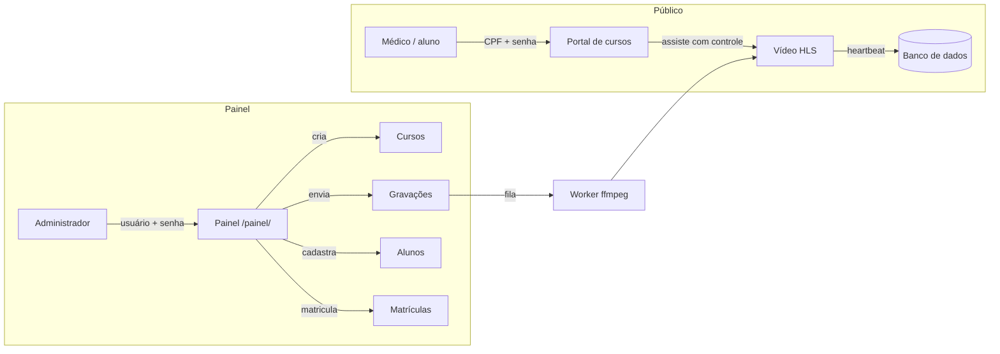
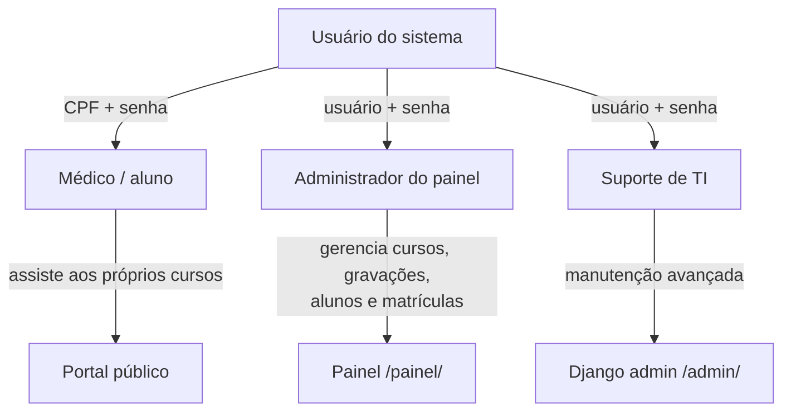
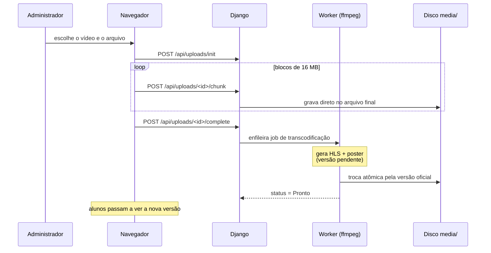
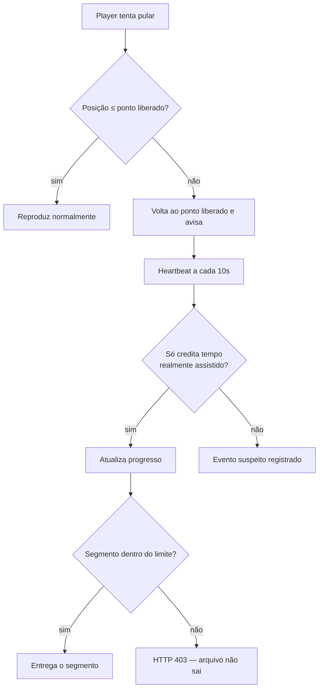
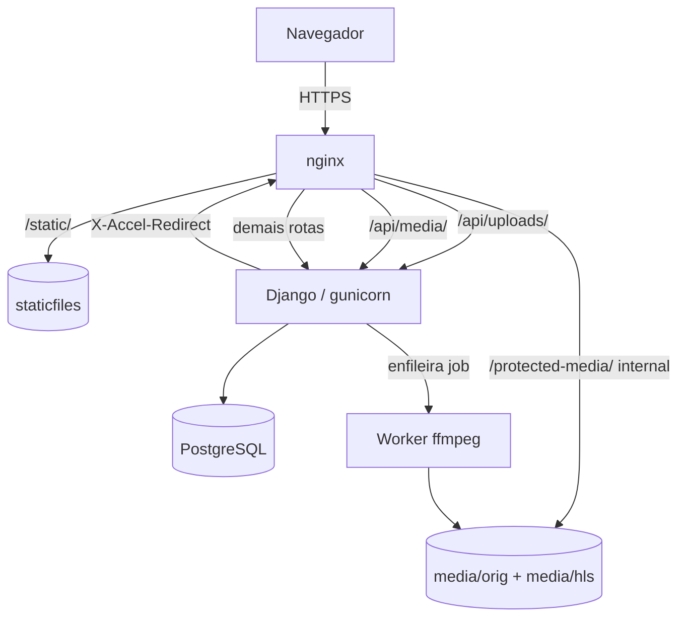

# Portal de Cursos da ESEM — CREMEPE

[](LICENSE)
[](https://www.djangoproject.com/)
[](#testes)

Portal web da **Escola Superior de Ética Médica (ESEM)** do **CREMEPE** para a
gestão de cursos, gravações, alunos e matrículas — com **acompanhamento de
evolução auditável** de cada aluno.

Serve para **qualquer curso** da ESEM (conferências, seminários, webnários,
cursos de atualização), não apenas para um evento específico.

---

## O que este sistema faz

Em vez de controlar presença manualmente, o portal garante — por construção —
que o aluno:

- **não consiga pular** o conteúdo que ainda não assistiu;
- **retome de onde parou**, mesmo que saia do sistema ou feche o navegador;
- tenha seu progresso **registrado e auditável** pelo CREMEPE.



### Para quem é cada acesso



| Perfil | Acesso | Login |
|---|---|---|
| Médico / aluno | Assiste aos cursos em que está matriculado | `/entrar/` (CPF + senha) |
| Administrador | Cria cursos, envia gravações, cadastra alunos e matricula | `/painel/entrar/` (usuário + senha) |
| Suporte de TI | Manutenção avançada do banco/dados | `/admin/` (superusuário) |

---

## Como funciona, na prática

| O que acontece | Como o sistema resolve |
|---|---|
| Gravações muito grandes (GB) | Upload **em blocos de 16 MB**, retomável, com SHA-256 por bloco; depois o `ffmpeg` gera **HLS** para streaming |
| Aluno não pode pular aula | 3 camadas de proteção: limite no player, validação do servidor e **recusa do segmento** além do ponto liberado |
| Aluno fecha o navegador | O progresso já está salvo; ao voltar ele retoma do mesmo ponto |
| Operação sem programador | **Painel completo** em `/painel/` — o Django admin fica só para o suporte |
| Regra de aprovação | `min_percent` configurável **por curso** (50% para reprovação, 100% para reciclagem) |
| Substituição de gravação | A versão antiga fica disponível até a nova processar; escolha se mantém ou reinicia o progresso |

---

## Fluxo de envio e processamento de uma gravação



> Enquanto a nova versão processa, a **antiga continua no ar**. Se o vídeo é
> totalmente diferente, o progresso dos alunos é reiniciado ao concluir; se é
> apenas uma nova versão do mesmo conteúdo, o progresso é mantido.

---

## Regras de bloqueio de avanço (o coração do sistema)



1. **No navegador** — ao tentar pular, o player volta ao ponto liberado e avisa o médico.
2. **No servidor** — o heartbeat só credita tempo enquanto o vídeo reproduz de verdade
   (máx. `PROGRESS_MAX_RATE` = 1,25× o tempo real, teto de 120 s). Um salto de 10 minutos
   em 5 segundos é recusado e registrado como **evento suspeito**.
3. **Entrega da mídia** — cada segmento HLS só sai se seu instante inicial estiver dentro
   do limite; caso contrário, **403**. As URLs são **assinadas (HMAC)** e expiram.

---

## Arquitetura técnica



Serviços (Docker Compose): `nginx`, `app` (gunicorn), `worker` (ffmpeg), `db` (PostgreSQL).

| Serviço | Papel |
|---|---|
| `nginx` | Proxy reverso; serve estáticos com cache e entrega a mídia via `X-Accel-Redirect` |
| `app` | Django (gunicorn): telas, API e validação de progresso |
| `worker` | Processa as gravações em segundo plano com `ffmpeg` |
| `db` | PostgreSQL: cursos, matrículas, progresso e auditoria |

---

## Requisitos

- Linux (Ubuntu 22.04/24.04 recomendado) com **Docker** e **Docker Compose v2**
- 4 vCPU, 8 GB RAM (16 GB se processar vários cursos em paralelo), SSD de 1 TB
- Domínio ou subdomínio do CREMEPE (recomendado para TLS via Let's Encrypt)

---

## Instalação (servidor do CREMEPE)

```bash
# 1. Código
git clone <repositorio> /opt/cremepe-esem && cd /opt/cremepe-esem

# 2. Configuração
cp .env.example .env
# Edite .env: DJANGO_SECRET_KEY, POSTGRES_PASSWORD, DJANGO_ALLOWED_HOSTS,
#              DJANGO_CSRF_TRUSTED_ORIGINS (https://cursos.cremepe.org.br)

# 3. Subir
docker compose up -d --build

# 4. Administrador do portal
docker compose exec app python manage.py criar_admin admin --email admin@cremepe.org.br
```

O administrador acessa o painel em **`/painel/entrar/`**. O **Django admin**
(`/admin/`) é exclusivo do suporte de TI (superusuários).

> **`DJANGO_ALLOWED_HOSTS` é obrigatório**: deve conter o domínio/IP pelo qual o portal será
> acessado (ex.: `cursos.cremepe.org.br,192.168.0.10`). Hostnames não permitidos são recusados
> com **HTTP 400** — inclusive nas chamadas internas entre containers (`nginx`, `app`).
> No ambiente local, use `localhost,127.0.0.1,nginx,app`.

O portal responde em `http://<servidor>:8080` (ou por HTTPS após configurar o certbot).

### HTTPS (recomendado)

```bash
docker compose exec app apt-get update && docker compose exec app apt-get install -y certbot
# ou use o certbot do host apontando para a porta 80/443
```

Depois, no `.env`: `SECURE_COOKIES=true` e `DJANGO_CSRF_TRUSTED_ORIGINS=https://...`.

---

## Estrutura de acesso

| Página | Endereço | Acesso |
|---|---|---|
| Apresentação e conteúdo institucional da ESEM | `/` | público |
| Acesso aos cursos (login) | `/entrar/` | público (login por CPF) |
| Meus cursos | `/cursos/` | aluno matriculado |
| Catálogo de cursos do admin | `/cursos/` | administrador |
| Página do curso | `/cursos/<id>/` | aluno matriculado |
| Acesso administrativo | `/painel/entrar/` | público (usuário + senha) |
| Painel administrativo | `/painel/` | administrador (`is_staff`) |
| Cadastro de alunos em lote | `/painel/medicos/lote/` | administrador |
| Usuários do painel | `/painel/usuarios/` | superusuário |
| Django admin (avançado) | `/admin/` | superusuário (suporte de TI) |

---

## Guia operacional (tudo pelo painel, sem Django admin)

### 1. Criar o curso

**Painel → Cursos → Novo curso**: título, turma/edição, imagem de capa, percentual
mínimo de aprovação (ex.: `50`), se os vídeos são liberados sequencialmente e o prazo.

### 2. Enviar as gravações

**Painel → Cursos → Abrir → Vídeo → Novo vídeo** (ordem e título).
Depois **Painel → Enviar gravação**: escolha o vídeo, o arquivo e clique em **Enviar arquivo**.

- Envio em blocos de 16 MB com **retomada**: se a conexão cair, tente de novo — o servidor
  continua de onde parou.
- Ao concluir, o `worker` processa e o vídeo passa a **Pronto**.
- **Substituição**: se o vídeo já existia, escolha entre *nova versão* (mantém o progresso)
  ou *vídeo diferente* (reinicia o progresso). A versão antiga fica no ar até a nova ficar pronta.

> Tempo de processamento: *remux* leva minutos; transcodificação completa (720p/540p/360p)
> pode levar de 1 a 3 horas para um curso de 6 h. Configure em `VIDEO_PIPELINE`.

### 3. Cadastrar os alunos

**Painel → Médicos → Novo médico**: nome completo, CPF e e-mail.

A **senha inicial padrão** é gerada automaticamente:

```
PrimeiroNome (sem acento, 1ª letra maiúscula) + "@" + CPF sem traços e pontos
Ex.: José da Silva / 123.456.789-00  ->  Jose@12345678900
```

O painel mostra a senha **uma única vez**; no **primeiro acesso** o sistema obriga a troca.

Para vários alunos de uma vez: **Painel → Médicos → Cadastrar em lote**
(envie um `.csv` ou cole os dados, separados por vírgula: `Nome, CPF, e-mail`).

### 4. Matricular

**Painel → Cursos → Abrir → Matriculados → matricular** (selecione um ou vários alunos)
ou **Painel → Matrículas → Nova matrícula**. O `min_percent` é copiado do curso e pode
ser ajustado por matrícula.

### 5. Acompanhar

- **Visão geral**: indicadores, progresso por curso, quem está mais adiantado e atividade recente.
- **Detalhe do curso**: descrição, distribuição do progresso, vídeos e turma.
- **Turma**: % de cada aluno, tempo em aula, última atividade e ações de
  **aprovar / reprovar / remover**.
- **Exportar CSV** da turma.
- **Auditoria**: registro de todas as ações administrativas.

### 6. Regras de aprovação

- O aluno é **aprovado automaticamente** quando a cobertura atinge `min_percent`.
- O painel permite **aprovar / reprovar / remover / resetar** manualmente.
- A cobertura é a **união das faixas assistidas** — reassistir não soma em dobro.

---

## Identidade institucional

O portal é o **Portal de Cursos da Escola Superior de Ética Médica (ESEM) do CREMEPE**.
Os textos institucionais seguem o conteúdo oficial da ESEM
([cremepe.org.br/escola-superior-de-etica-medica](https://www.cremepe.org.br/escola-superior-de-etica-medica)):

- Núcleo técnico permanente responsável por conferências, seminários, fóruns e cursos
  sobre ética e bioética na medicina.
- Criada pelas Resoluções CREMEPE 03/2005 e 08/2011.
- Pioneira no Nordeste; coopera com a FPS e a UFPE.

O endereço antigo `/sobre/` redireciona para `/`, que concentra todo o conteúdo institucional.

Verificação automática (conteúdo da ESEM, acentos e escopo):

```bash
python scripts/conferir_identidade.py
```

> Os scripts de diagnóstico leem credenciais de `MEDICO_CPF`, `MEDICO_SENHA`,
> `MEDICO_SENHA_INICIAL`, `MEDICO_SENHA_NOVA` e `ADMIN_SENHA`. Nenhuma senha fica
> no repositório.

---

## Sessão e cookies

O portal usa a sessão do Django (backend de banco). Estes cuidados evitam o problema
clássico de **"sair sozinho ao recarregar"**:

| Cuidado | Por quê |
|---|---|
| Logout só por **POST** | Evita que um clique acidental ou prefetch derrube a sessão |
| `no-store` nas páginas e no login | Evita reaproveitar um 302 antigo de login |
| **Cookie órfão é apagado** | Se o navegador enviar uma sessão que já não existe, a resposta zera o cookie |
| **Nomes de cookie próprios** (`cremepe_sid`, `cremepe_csrftoken`) | Evita que extensões/proxies reescrevam os cookies padrão do Django |
| **Token de API assinado** (`Authorization: Bearer ...`) | Se o cabeçalho `Cookie` for reescrito, o vídeo continua reproduzindo |
| `SessaoUnicaMiddleware` | Se houver cookies duplicados, escolhe o que ainda existe no banco |

Se o navegador estiver com cookies antigos: **DevTools → Application → Storage → Clear site data**.

---

## Backup

```bash
# ./scripts/backup.sh  (no host; usa pg_dump + rsync)
30 2 * * * /opt/cremepe-esem/scripts/backup.sh
```

Gera `backups/db-<timestamp>.dump` e `backups/media/`, com retenção de 30 dias.
**Teste a restauração trimestralmente.**

---

## Testes

```bash
docker compose exec app python manage.py test apps      # testes automatizados
MEDICO_CPF=... MEDICO_SENHA=... python scripts/smoke_test.py  # ponta a ponta
```

O `smoke_test.py` valida contra o portal no ar: login, heartbeat, recusa de salto,
bloqueio de segmento (403) e liberação de segmento (200).

```bash
# contra um curso/vídeo específico
BASE_URL=http://servidor:8080 MEDICO_CPF=12345678901 MEDICO_SENHA=xxx \
    MATRICULA_ID=2 VIDEO_ID=5 python scripts/smoke_test.py
```

Verificação do CSS (confere se todas as classes dos templates existem no Tailwind compilado):

```bash
python scripts/conferir_css.py
```

Jornada completa do **primeiro acesso** de um aluno (login com a senha inicial →
troca obrigatória → acesso ao curso → reprodução):

```bash
export MEDICO_CPF=... MEDICO_SENHA_INICIAL=... MEDICO_SENHA_NOVA=...
python scripts/jornada_primeiro_acesso.py
```

Verificação da **entrega do stream** (manifesto, tags HLS, bytes do segmento):

```bash
export MEDICO_CPF=... MEDICO_SENHA=... MEDICO_SENHA_NOVA=...
python scripts/verificar_stream.py
```

> Ambos realizam a troca de senha. Para restaurar a senha inicial depois dos testes:
> ```bash
> docker compose exec app python manage.py cenario_inicial \
>     --cpf 12345678900 --nome "José da Silva" --resetar-senha
> ```

Cenário de demonstração (curso, encontros, aluno e matrícula):

```bash
docker compose exec app python manage.py cenario_inicial \
    --cpf 12345678900 --nome "José da Silva" \
    --curso-id 1 --resetar-senha --zerar-progresso
```

---

## Front-end

- **Tailwind CSS v4** compilado com o CLI standalone e versionado em `static/css/tailwind.css`
  (o servidor **não** precisa de Node). Ver `docs/design-system.md`.
- Ícones SVG inline (Heroicons) via context processor — sem CDN, sem dependência externa.
- Para alterar o visual, recompile:

  ```bash
  tools/tailwindcss.exe -i frontend/tailwind.css -o static/css/tailwind.css --minify
  ```

### Cache dos arquivos estáticos

O `nginx` serve `/static/` com cache de 30 dias. O Django usa **`ManifestStaticFilesStorage`**:
cada arquivo ganha um hash no nome (`player.43bc9564fa1a.js`). Ao alterar CSS/JS, o hash muda
e o navegador baixa a versão nova.

> Se o navegador continuar mostrando a versão antiga, force com **Ctrl+F5**.

---

## Variáveis de ambiente importantes

| Variável | Padrão | Descrição |
|---|---|---|
| `PROGRESS_MAX_RATE` | `1.25` | Velocidade máxima que gera crédito de progresso |
| `SEGMENT_TOLERANCE_SECONDS` | `12` | Tolerância além do ponto liberado (cobre o buffer do hls.js) |
| `HEARTBEAT_INTERVAL_SECONDS` | `10` | Intervalo entre batidas do player |
| `UPLOAD_CHUNK_SIZE` | `16777216` | Tamanho do bloco de upload (16 MB) |
| `HLS_TOKEN_TTL_SECONDS` | `28800` | Validade das URLs assinadas (precisa cobrir o vídeo) |
| `API_TOKEN_TTL_SECONDS` | `28800` | Validade do token de API usado pelo player |
| `HLS_SEGMENT_SECONDS` | `4` | Duração de cada segmento HLS |
| `MEDIA_ROOT` | `/srv/media` | Raiz da mídia (originais + HLS) |
| `EXIGIR_TROCA_SENHA` | `true` | Exige troca da senha no 1º acesso. **Em produção, mantenha `true`.** |

---

## Estrutura do projeto

```
config/            settings, urls, wsgi
apps/accounts/     alunos, login por CPF, troca de senha
apps/courses/      cursos, vídeos, matrículas, progresso
apps/media/        upload em blocos, worker ffmpeg, entrega do HLS
apps/panel/        painel administrativo (operação completa)
apps/web/          ícones, filtros de template e identidade visual
templates/         telas (Tailwind, renderização no servidor)
static/            player.js, upload.js, app.js (sem CDN)
frontend/          fonte do Tailwind (compilado para static/css/tailwind.css)
scripts/           backup, smoke test, upload via linha de comando
nginx/             proxy reverso
docs/              sistema de design e decisões técnicas
```

---

## Segurança e LGPD

- Senhas com PBKDF2; sessão `HttpOnly` + `SameSite`; CSRF ativo.
- Login com mensagem genérica + rate limit no nginx.
- O aluno só acessa as próprias matrículas e mídia (testes cobrem isso).
- Dados pessoais e logs de acesso exigem base legal, aviso de privacidade
  e política de retenção — ver `docs/decisoes-tecnicas.md`.

---

## Licença

Este projeto está sob a [GNU Affero General Public License v3.0 (AGPL-3.0)](LICENSE).

A AGPL foi escolhida por ser a licença **mais adequada a um serviço web de interesse
público**: ela garante que qualquer versão modificada — inclusive a rodada como serviço
pela rede — mantenha seu código-fonte disponível à comunidade. É a licença adotada com
frequência por projetos de software público brasileiro.

```
Copyright (C) CREMEPE — Conselho Regional de Medicina de Pernambuco
```

Você pode redistribuir e/ou modificar este programa sob os termos da GNU AGPL v3.
Consulte o arquivo [LICENSE](LICENSE) para o texto completo.
